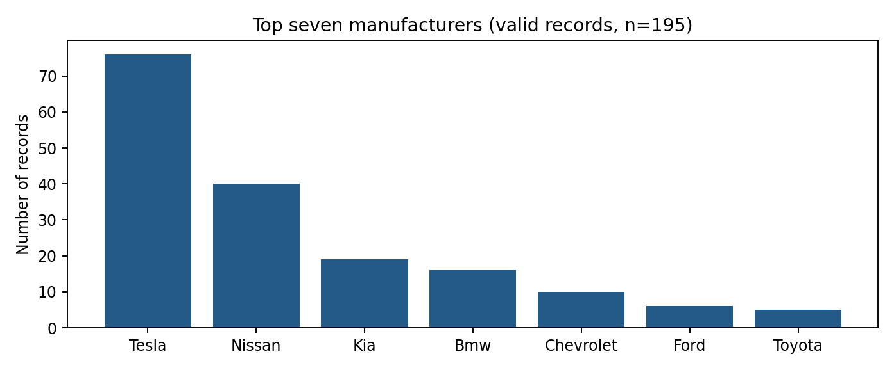
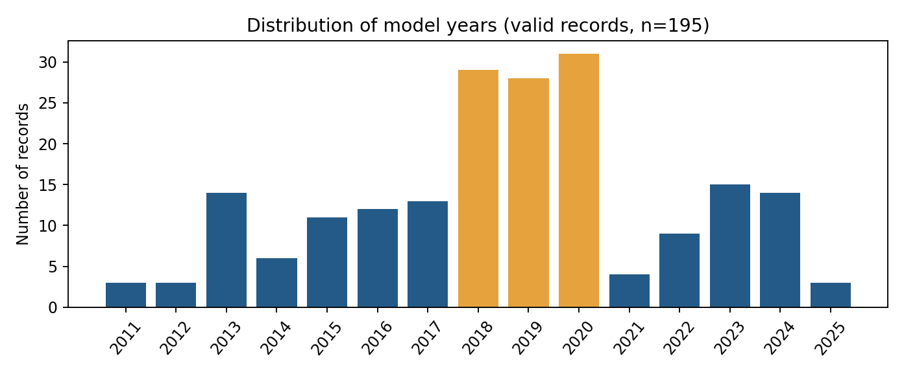

# Electric Vehicle Exploratory Data Analysis | MIS 311

## Project overview
This project explores a course-provided electric vehicle dataset using Microsoft Excel to demonstrate data cleaning, descriptive statistics, and evidence-based business insights.

## Dataset and source
- Source: MIS 311 course-provided `08_Electric Vehicle.xlsx` (original collection source and sampling method unspecified)
- Original data: **202 records × 6 columns**
- Variables: Vehicle Identification Number, City, Postal Code, Model Year, Make, Model

## Data cleaning
- Removed **3 exact duplicate records** → **199 unique records**.
- Audited missing values: **11** records have at least one missing field.
- Missing values were retained in the cleaned dataset; analyses requiring Make and Model Year used **195 valid records**.

## Descriptive statistics
- Mean model year: **2018.59**
- Median model year: **2019**
- Model year range: **2011–2025**

## Key insights
### 1. Tesla leads the manufacturer distribution
Tesla accounts for **76 of 195 records (39.0%)** in the valid analytical subset. This indicates Tesla's prominence in this sample, but does not establish its market share.

### 2. Model years 2018–2020 are the largest three-year cluster
The years 2018–2020 represent **88 of 195 records (45.1%)**. The median model year is **2019**, suggesting concentration around this period rather than evidence of a sales trend.

## Project files
- `08_Electric_Vehicle.xlsx` — original dataset
- `MIS311_Electric_Vehicle_FINAL.xlsx` — Excel workbook with raw and cleaned data, data quality, descriptive statistics, frequency tables, and insights
- `Electric_Vehicle_EDA_Report.pdf` — full report with charts and interpretation
- `ev_make_chart.png`, `ev_year_chart.png` — figures displayed above

## Limitations
This is a small, course-provided sample without documented population coverage, collection date, or sampling procedure. Results should not be generalized to the entire EV market.

## Reference
MIS 311 course-provided dataset. (n.d.). *08_Electric Vehicle* [Unpublished dataset]. Original source not specified.
